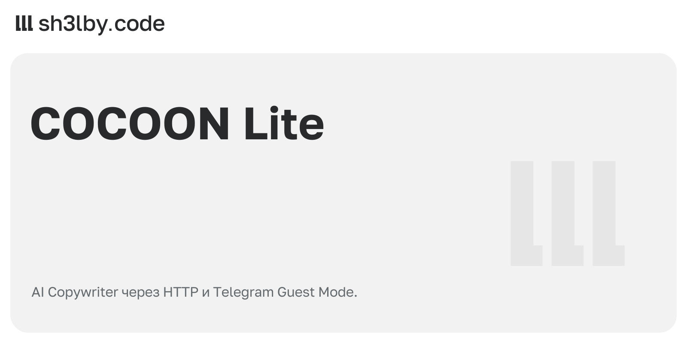

# COCOON Lite

<!-- portfolio-card:start -->
[](docs/portfolio/card.svg)
<!-- portfolio-card:end -->

Вызывать AI Copywriter из редактора статей Telegram через HTTP API или своего бота. COCOON Lite отправляет запрос от пользовательской Kurigram-сессии, преобразует ответ в rich Markdown и возвращает форматированную статью. Бот работает в личке, группах и Guest Mode.

Небольшой self-hosted прототип: FastAPI, SQLite, один процесс. Используется `messages.ComposeRichMessageWithAI` — тот же метод генерации статей, что в Telegram Desktop. Отдельный TON-кошелёк не нужен; доступ и квоты определяет Telegram.

Обсудить похожий проект: [sh3l.beer](https://sh3l.beer).

## Что оценить

- Один генератор для HTTP API и Telegram-бота. При занятой сессии запрос отклоняется сразу, без скрытой очереди и повторной генерации.
- Перевод нативных блоков статьи в rich Markdown: заголовки, выделение, ссылки, списки, цитаты, код, формулы, таблицы и раскрывающиеся секции.
- Guest Mode через `guest_message` и `answerGuestQuery`: бот может отвечать в поддерживаемом чате без добавления в участники.
- Разделение истории по пользователю, чату, топику и режиму guest/member. В HTTP API история привязана к `conversation_id`.
- Экспериментальная память: проверка структурированного ответа и атомарная запись истории с заметкой в SQLite. По умолчанию отключена.

## Как это устроено

```text
HTTP /generate ─┐
                ├─ Engine → Kurigram / MTProto → Telegram AI Copywriter
Telegram-бот ───┘     │                              │
                     └─ SQLite ← проверка ответа ← RichMessage
```

В Copywriter передаётся `InputAiComposeToneSingleUse.custom_prompt`, без поля `text`. Метод исправления текста `messages.ComposeMessageWithAI` не используется. Успешный ответ сохраняется в истории и возвращается клиенту. Бот отправляет его через `sendRichMessage`, в Guest Mode — через `answerGuestQuery` с `InputRichMessageContent`.

**По умолчанию `USE_CONTEXT=false`: модель получает только текущий запрос.** Системная инструкция, история, память и текст сообщения, на которое сделан reply, не добавляются. История сохраняется локально, существующая память остаётся на месте. Поле `system` в API принимается, но в этом режиме игнорируется.

## Запуск

Нужны Python 3.12+, Git и свой Telegram-аккаунт с доступом к AI Copywriter. Для локального запуска используется пользовательская Premium-сессия. Наличие подписки само по себе не подтверждает доступность метода для аккаунта.

```bash
git clone https://github.com/proger-exe/cocoon-lite.git
cd cocoon-lite
python3 -m venv .venv
source .venv/bin/activate
pip install -r requirements.txt
cp .env.example .env
```

1. Получи `TG_API_ID` и `TG_API_HASH` на [my.telegram.org](https://my.telegram.org) и запиши в `.env`.
2. Запусти `python login.py`, войди в свой аккаунт и сохрани выданную `TG_SESSION_STRING` в `.env`. Она даёт доступ к аккаунту; это секрет, как и пароль.
3. Сгенерируй `API_KEY`: `python -c 'import secrets; print(secrets.token_urlsafe(32))'`. Сохрани результат в `.env`.
4. Запусти сервис:

```bash
uvicorn app:app --host 127.0.0.1 --port 8000 --workers 1 --no-access-log
```

После настройки `.env` можно использовать `docker compose up --build -d`. Порт Docker опубликован только на `127.0.0.1`, SQLite хранится в именованном volume.

Нужен **один процесс и одна реплика**: блокировка генерации и polling не рассчитаны на несколько экземпляров. Без `BOT_TOKEN` работает только HTTP API.

### Telegram-бот

Создай бота у [@BotFather](https://t.me/BotFather), включи Guest Mode и задай `BOT_TOKEN` и `ALLOWED_USER_IDS` в `.env`. После перезапуска можно писать в личку бота, упоминать его в группе или отвечать на его сообщения. Для Guest Mode используй `@имябота запрос` в поддерживаемом чате.

Без списка разрешённых пользователей бот не запускается. Сообщения остальных пользователей игнорируются. У бота не должно быть активного webhook или второго polling-процесса.

| Команда | Действие |
| --- | --- |
| `/memory` | Показать заметку текущего диалога |
| `/reset` | Удалить историю, сохранив заметку |
| `/forget` | Удалить заметку и историю |

В Guest Mode команда передаётся с упоминанием: `@имябота /memory`. В группе ответ с содержимым памяти виден участникам этой группы.

### Конфигурация

| Переменная | Назначение / значение по умолчанию |
| --- | --- |
| `TG_API_ID`, `TG_API_HASH` | Реквизиты Telegram-приложения, обязательны |
| `TG_SESSION_STRING` | Пользовательская MTProto-сессия, обязательна |
| `API_KEY` | Общий bearer token для API, минимум 24 символа |
| `BOT_TOKEN` | Токен бота; пустое значение отключает polling |
| `ALLOWED_USER_IDS` | Числовые Telegram ID через запятую, обязательны для бота |
| `DB_PATH` | `data/context.sqlite3` |
| `USE_CONTEXT` | `false`; `true` включает экспериментальный контекст и запись памяти |
| `MAX_TURNS` | `12` последних пар сообщений в истории |
| `MAX_CONTEXT_CHARS` | `12000`; несмотря на имя, локальный предел в **байтах UTF-8** |
| `SYSTEM_PROMPT` | Инструкция для режима контекста; при `USE_CONTEXT=false` не используется |

Действующий предел запроса — меньшее из `MAX_CONTEXT_CHARS` и `aicompose_tone_prompt_length_max`, полученного от Telegram. Если Telegram не вернул настройку, используется 1024. Изменения `.env` требуют перезапуска.

## HTTP API

Все перечисленные маршруты требуют `Authorization: Bearer <API_KEY>`. Это API одного владельца: ключ даёт доступ ко всем API-диалогам; `conversation_id` не является отдельным правом доступа.

| Метод | Путь | Назначение |
| --- | --- | --- |
| `POST` | `/generate` | Генерация и сохранение пары сообщений |
| `GET` | `/context/{conversation_id}` | История |
| `DELETE` | `/context/{conversation_id}` | Удалить историю, оставить память |
| `GET` | `/memory/{conversation_id}` | Прочитать память |
| `DELETE` | `/memory/{conversation_id}` | Удалить память и историю |
| `GET` | `/health` | Подключение MTProto и состояние задачи бота |

Для примера ниже задай `API_KEY` также в окружении своего терминала: `curl` не читает `.env` приложения.

```bash
curl http://127.0.0.1:8000/generate \
  -H "Authorization: Bearer $API_KEY" \
  -H 'Content-Type: application/json' \
  -d '{"prompt":"Придумай три названия для проекта","conversation_id":"demo"}'
```

```json
{"conversation_id":"demo","text":"…","format":"rich_markdown"}
```

Без `conversation_id` создаётся новый идентификатор. `text` содержит Telegram rich Markdown; для веб-интерфейса нужен безопасный рендерер. При `USE_CONTEXT=true` можно передать поле `system` и продолжить разговор с тем же ID.

Основные ошибки: `401` — неверный ключ, `413` — превышен бюджет запроса, `429` — генератор занят или действует FloodWait, `502` — Telegram отклонил запрос либо ответ не прошёл проверку, `504` — таймаут. Ошибки схемы запроса возвращают `422`. Сброс истории и памяти во время генерации возвращает `409`.

## Экспериментальный контекст и память

Включаются через `USE_CONTEXT=true`. К запросу добавляются инструкция, последние пары сообщений и заметка текущего диалога. Старые полные пары удаляются из отправляемого контекста по мере заполнения бюджета. Если последний запрос с инструкцией и памятью не помещается, генерация отклоняется.

Модель может вернуть JSON `{"text":"ответ","memory":"новая заметка"}`. Строка полностью заменяет память, пустая строка очищает её, `null` или отсутствие поля сохраняют прежнее значение. После проверки формата история и память записываются одной транзакцией. Обычная статья сохраняется в истории без изменения памяти; некорректный или частичный ответ отклоняется без записи.

Заметка ограничена четвертью действующего бюджета запроса, максимум 3000 байт UTF-8. При лимите 1024 это всего 256 байт. Команда `/reset` оставляет заметку, `/forget` удаляет и заметку, и историю, чтобы старые факты не вернулись из контекста. Между чатами память не переносится.

Это протокол поверх Copywriter: запись факта проверяется через `/memory`. Инструкция не сохранять секреты не гарантирует правильность отбора фактов. SQLite хранит историю и заметки без шифрования.

## Ограничения и статус

- Это доступ к генератору статей Telegram: нет выбора модели, streaming, инструментов или совместимости с OpenAI Chat Completions. Короткое `2+2` в режиме без контекста может вернуться как текст статьи; формулируй нужное действие явно.
- Telegram может отклонить запрос с `AICOMPOSE_TONE_PROMPT_INVALID` даже ниже объявленного лимита. Локальная проверка длины не гарантирует приём; режим контекста пока экспериментальный.
- Поддерживаются текстовые блоки, H1–H6, формулы, вложенные цитаты, списки, код, details и таблицы. Объединённые ячейки теряют объединение. Перенос медиа не реализован; неизвестный блок отклоняется.
- Входящий запрос берётся из текста сообщения или подписи. Чтение входящих статей и вложений не реализовано. Локальный предел ответа — 32768 символов Markdown; Telegram дополнительно проверяет структуру.
- Вызов Copywriter выполняется один раз: ожидание ответа до 55 секунд, общий таймаут 60 секунд. Сетевая ошибка не вызывает скрытой повторной генерации.
- История сохраняется до отправки ботом. Ошибка доставки не откатывает успешную генерацию; update с ошибкой пропускается. Сбой между отправкой и сохранением polling offset может привести к повтору ответа.
- При локальной проверке подтверждены подключение Telegram и ответы HTTP API. Доставка и отображение всех видов rich-блоков в реальном Guest Mode ещё не подтверждены.

## Стек и проверки

Python 3.12+, FastAPI, Kurigram, httpx и SQLite. Kurigram закреплён на commit с нужными raw TL-конструкторами; его исходники устанавливаются через Git.

```bash
pip install -r requirements-dev.txt
python -m pytest -q
```

42 теста проверяют сериализацию Copywriter-запроса, рендеринг статей, отключение контекста, HTTP-авторизацию, изоляцию истории, атомарность памяти и маршрутизацию бота. Вызовы Telegram подменены: для тестов не нужны токены или личная сессия. GitHub Actions запускает тот же набор на Python 3.12.

```text
app.py                 API, Copywriter, конвертер статей, SQLite и polling
login.py               получение пользовательской Telegram-сессии
.env.example           шаблон настроек без секретов
test_app.py            локальные тесты
compose.yaml           запуск одного экземпляра с постоянным volume
docs/portfolio/        баннер README в PNG и SVG
```

`.env`, сессии, базы, логи и окружение Python исключены из Git. Docker получает только файлы сборки и приложения; рабочие данные не попадают в build context.

## Источники

- [Генерация статьи в Telegram Desktop](https://github.com/telegramdesktop/tdesktop/blob/5d33d4d02a735a9f386de5fa1282511d03fa9b4a/Telegram/SourceFiles/boxes/create_ai_box.cpp)
- [Telegram AI API](https://core.telegram.org/api/ai)
- [Guest Mode](https://core.telegram.org/api/bots/guest-mode)
- [Отправка rich-сообщений](https://core.telegram.org/bots/api#sendrichmessage)
- [Форматирование rich-сообщений](https://core.telegram.org/bots/api#rich-message-formatting-options)
- [Закреплённая TL-схема Kurigram](https://github.com/kurigram-org/kurigram/blob/3a6c0dd6176786c58fe8215cb7d8f81199b9f51f/compiler/api/source/main_api.tl)

## Лицензия

[MIT](LICENSE).
